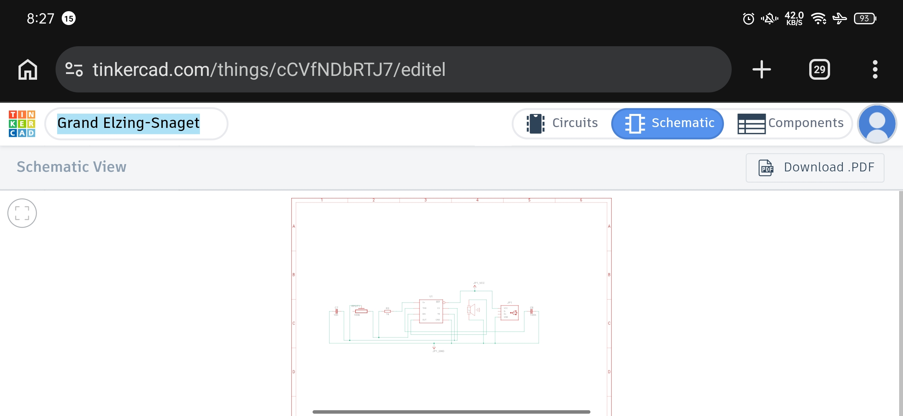

# ProTone-
My project name is TripleTone. I want to make a music instrument using aa 555 timer IC. Each IC will make different sounds. I will use potentiometers to change the sound and try to make different music. The circuit will be connected to a small speaker using an audio amplifier
Timer IC NE555, DIP-8 1
2 IC socket 8-pin DIP 1
3 Fixed resistor R1 1 kΩ, ¼ W 1
4 Variable resistor 100 kΩ linear pot5 Timing capacitor C1 100 nF (0.1 µF), ceramic 1
6 Control capacitor C2 10 nF (0.01 µF), ceramic 1
7 Power decoupling capacitor 100 nF, ceramic 1
9 bazar 
10 Breadboard Solderless 1
11 Jumper wires Male-to-male 1 set
12 Power supply Regulated 5 V USB supply 1
13 USB power cable Compatible with

